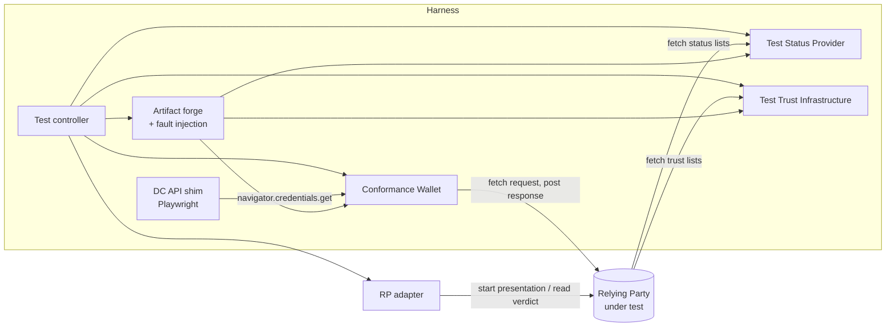

# RP conformance harness: design

Draft 0.4, 2026-11-11. Phases 0 to 3 (section 11) are implemented in `packages/` and `adapters/`; see the README for how to run it. It describes the tool that executes the Relying Party test cases in [fcaf-overlay](fcaf-overlay/README.md) (121 baseline test cases) against any Relying Party, EUDIPLO first.

## 0. Summary

The harness plays every party around the Relying Party (RP): the wallet, the issuers, the status provider and the trust infrastructure. It sends the RP valid material and material with exactly one deliberate fault, then reads the RP's verdict and compares it with the expected result of the FCAF test case.

Key choices:

- **TypeScript monorepo**, same stack as EUDIPLO and WILMA, built on the OWF libraries (`@owf/*`, `@sd-jwt/*`, `@openid4vc/*`). They already create JOSE, COSE, SD-JWT VC, mdoc (including MSO status and identifier lists), Token Status Lists, X.509 certificates and CRLs, LoTEs with JAdES seals, and access and registration certificates.
- **Valid first, then one fault**: every artifact is built valid with the libraries, then a named mutation is applied in a separate fault-injection layer that assembles JOSE/COSE directly, so strict library validation never blocks a deliberately broken artifact.
- **The harness proves its own faults**: before a mutation is used against an RP, a reference validator confirms that the unmutated artifact passes every check and the mutated one fails exactly the targeted check.
- **RP-agnostic through adapters**: one small interface (start a presentation, read the verdict, optionally refresh trust). EUDIPLO gets the first adapter; a manual adapter covers RPs without an API.
- **Executable test definitions are the single source of truth**: the FCAF markdown is rendered from them, so the specification and the executed test cannot drift.

## 1. Goals and non-goals

Goals:

1. Execute the FCAF Relying Party test cases unattended and produce FCAF verdicts (PASS, FAIL, INCONCLUSIVE, NOT APPLICABLE, REVIEW) with evidence.
2. Work with any RP that offers the ICS items and a way to read its verification result.
3. Run in CI: nightly against EUDIPLO's main image, and on demand against other RPs.
4. Make every negative verdict explainable: which fault, which artifact, what the RP answered, what the status provider and trust infrastructure saw.

Non-goals for now:

- Testing wallets or issuers (WILMA and the OIDF suites cover those).
- Proximity flows (ISO/IEC 18013-5 device engagement); the FCAF approach is to adopt ISO/IEC TS 18013-6 reader tests by reference.
- Testing the browser's Digital Credentials API implementation; the harness replaces it with a shim (§4.5).
- Load, penetration and availability testing.

## 2. What the baseline needs from a harness

Derived from the 121 baseline test cases ([packages/definitions](packages/definitions)):

| Capability | Used by | Notes |
| --- | --- | --- |
| Start a presentation at the RP for a default query and flow | all | Through the RP adapter |
| Answer a signed OpenID4VP request via redirects (`direct_post.jwt`) | all `a` variants, `SessionEncryption_*a` | Same-device flow including the redirect back |
| Answer via the W3C Digital Credentials API (`dc_api.jwt`) | `SessionEncryption_*b`, every test case once per supported flow | Browser shim |
| Issue PID SD-JWT VC and mdoc, with variants | `Validity`, `Revocation`, `TrustMechanisms` | Claims, validity, status reference, issuer, signature |
| Issue QEAA, PuB-EAA and non-qualified EAA | `TrustMechanisms_010`–`_015` | QEAA needs a Trusted List in XML |
| Build KB-JWT and mdoc DeviceAuth bound to the request | all | Valid in the baseline; faults come with `SessionBinding` and `DeviceBinding` later |
| Encrypt the response, with faults | `SessionEncryption` | JWE `alg`, `enc`, `epk`, `kid`, target key, tampering, unencrypted, JWS |
| Serve Status List Tokens (JWT, CWT) and identifier lists, with faults | `Revocation`, `RP_PP_SM_Revocation` | Signature, signer, claims, type, `lst`, `bits`, size |
| Log status list retrievals per credential | `Validity_005`, `_006`, `Revocation_001`, `_010`, `RP_PP_*` | Evidence for `NOFETCH` and `FETCHED` |
| Publish LoTEs and Trusted Lists, and new versions during a test | all; `TrustMechanisms_007`, `_008` | Logs retrievals |
| Test PKI per the trust configuration | all | `PP-A` … `CA-X`, revocation anchors, expired anchor |
| Read the RP verdict and released attributes | all | Through the RP adapter |
| Read the RP's ICS values (`T_skew`, `T_kb`, `T_refresh`, policies) | time faults, `NOSTAT`, list refresh | ICS file per RP |

The distinct faults (§4.3) number about 70; most are reused across test cases and variants.

## 3. Architecture



| Component | Responsibility |
| --- | --- |
| Test controller | Loads the ICS and the test definitions, selects applicable test cases, runs positive controls first, executes steps, evaluates expected results, writes the report. CLI and HTTP API. |
| Artifact forge | Test PKI, credentials, presentations, responses, status lists, identifier lists, LoTEs, Trusted Lists. Builds valid artifacts, applies named faults. |
| Conformance Wallet | Wallet side of OpenID4VP: resolves `request_uri`, validates the request, builds and sends the response the step defines, follows or withholds the redirect. |
| DC API shim | Opens the RP's DC API page in Playwright and replaces `navigator.credentials.get` so the request goes to the Conformance Wallet and its response comes back to the page. |
| Test Status Provider | Serves status artifacts registered per credential under unique URLs, with programmable HTTP behaviour; logs every request. |
| Test Trust Infrastructure | Serves LoTEs and Trusted Lists per namespace, versioned; logs every retrieval. |
| RP adapter | The only RP-specific code: configure the RP, start a presentation, read the verdict, trigger a trust refresh. |

All harness services run in one process or as containers on one Docker network with fixed host names (`wallet.rp-test`, `status.rp-test`, `trust.rp-test`), served over TLS by a harness CA that the RP trusts (part of `default_configuration_rp_1`).

## 4. Components

### 4.1 Test controller

1. **Selection**: evaluates `Profile applicability` against the RP's ICS file; unmet conditions give NOT APPLICABLE.
2. **Gating**: runs each positive control (`RP_WS_IA_MainInteraction_001a`, `_001b`, and the per-flow equivalents) first. A test case whose control did not pass ends INCONCLUSIVE.
3. **Execution**: steps run in order; each step produces evidence and a step verdict; the test case passes only if every step passes.
4. **Flows**: the controller repeats every test case once per flow the RP supports, as the FCAF test cases instruct, and reports per flow. Implementation (Phase 3): `flowsOf(definition)` is the flow the profile names (the `SessionEncryption` variants: RP.P.1 for `a`, RP.P.2 for `b`), otherwise both flows; a test case runs in each of those flows the run selects (`--flows`, default both), is NOT APPLICABLE in a flow the ICS does not declare, and is gated by its control's verdict in the same flow. A test checks that every definition without a flow in its profile carries the comment "Execute this test case once for each presentation flow".
5. **Scheduling**: test cases that only touch their own namespace run in parallel; test cases that change shared state (trust list versions) run serially unless the adapter supports namespaces (§6).

### 4.2 Executable test definitions

Each FCAF test case has one definition in `packages/definitions`. It holds every FCAF field and the executable steps, so the markdown is rendered from it and cannot disagree with what runs.

| FCAF section | Definition field | Rendering |
| --- | --- | --- |
| Title | `id` | `# <id>`; class, layer and area in the ID give the file location |
| Objective | `objective` | Paragraph |
| References | `references` | Bullet list |
| Profile applicability | `profile` (ICS conditions: item, exact `ics-rp.md` text, answer) | Bullet list of the texts, or `None`; the controller evaluates the items against the ICS |
| EUDI-wallet relevancy | `relevancy` | One of the five FCAF values |
| Technology | `technology` | Bullet list; left out when empty |
| Preconditions | `preconditions` | Numbered list, or `None`; the positive controls they name must equal `control`, which gates execution |
| Test Scenario | `steps[].text` | Numbered list |
| Expected results | `steps[].expect.text` | Numbered list; `steps[].expect.codes` (`ACC`, `REJ`, `NOSTAT`, ...) is what the controller evaluates |
| Comments | `comments` | Paragraphs; left out when empty |

Shared wording lives in `packages/core/src/wording.ts`: the preconditions, the expected results (`acc()`, `rej()`, `nostat()`, `fetched()`, `nofetch()`, combined with `all()`), the scenario texts (`scenario.credentialVariant(...)`, `scenario.statusListToken(...)`, ...), the comments, and the format and flow texts. Step builders such as `presentationStep.valid(...)` return the scenario text together with the executable action, so a fault and its description are written in one place.

```ts
// packages/definitions/src/pid_provider/SecurityMechanisms/Revocation.ts (abridged): one function per format
defineTestCase({
  id: 'RP_PP_SM_Revocation_004a_UF',
  objective: 'Verify that the Relying Party does not use an expired Status List Token in JWT format.',
  references: ['[Token Status List] section 5.1, 8.3' /* … */],
  profile: [formats.sdJwtVc.profile, ics.checksPidRevocation],
  relevancy: relevancy.genericRequired,
  technology: [formats.sdJwtVc.technology, formats.sdJwtVc.statusListTechnology],
  preconditions: [...preconditions.base, preconditions.control('RP_WS_IA_MainInteraction_001a'), preconditions.freshStatusList],
  control: 'RP_WS_IA_MainInteraction_001a',
  steps: [
    // The fault names the scenario text ("…, except that its `exp` claim is set to …") and the executable action.
    step({ ...presentationStep.statusListFault('status-list.exp-past'), expect: nostat() }),
  ],
  comments: [comments.nostat, comments.flow],
});
```

The definitions are grouped by area (`packages/definitions/src/<class>/<layer>/<Area>.ts`); where the FCAF test cases of an objective differ only in the credential format or the flow, one function produces each variant, and the variant a later phase implements carries text only (steps without `run`). The controller executes only definitions whose steps all have an action.

`packages/fcaf-render` renders the whole overlay `fcaf-overlay/docs/fcaf` (`pnpm fcaf:render`): the test cases from the definitions, the overview, area and layer pages and baseline lists, the Relying Party ICS and defaults from `packages/fcaf-render/pages`, and the four modified FCAF pages from their unmodified originals in `packages/fcaf-render/upstream` (`submitted` at `0ed4ab1`). `pnpm test` and CI fail when the committed overlay differs from the rendered one, and CI runs the patched FCAF lint (`scripts/fcaf-lint.sh`, `fcaf-overlay/fcaf_lint-rp.patch`) on the rendered output with every finding blocking. The Python generator this replaced was removed in Phase 1, after the port had reproduced its 121 test cases and 21 shared pages byte for byte.

### 4.3 Artifact forge and fault injection

Two layers:

- **Builders** create valid artifacts with the OWF libraries: `@sd-jwt/sd-jwt-vc` and `@sd-jwt/core`, `@owf/mdoc`, `@owf/token-status-list`, `@owf/x509`, `@owf/eudi-lote` with `@owf/eudi-jades`, `@owf/eudi-access-certificate`, `@owf/eudi-registration-certificate`, `@owf/jose`, `@owf/cose`.
- **Faults** are pure, named functions applied at one of six points. Where a library would refuse the faulty input, the fault works on the decoded structure and re-assembles JOSE or COSE directly (WebCrypto signing).

| Point | Faults in the baseline |
| --- | --- |
| Credential, before signing | `exp`/`nbf` shift; MSO `validFrom`/`validUntil`/`expectedUpdate` shift; issuer selection (any entity of the trust configuration); status reference removed, malformed (5 kinds) or out of range; identifier list reference |
| Credential, after signing | issuer signature bit flip |
| Response | JWE `enc` choice; `alg` key-wrap variants; `enc` CBC; target key foreign or of another transaction with copied `kid`; ciphertext or tag bit flip; `epk` off-curve or other curve; JWS or `alg: none` instead of JWE; unencrypted `direct_post`; unencrypted DC API `data`; extra payload member |
| Status List Token | signature bit flip; `alg: none`; bare list; `exp` shift; `sub` change; wrong `typ`/type; each required claim removed; signer from `CA-X`, without `x5c`, self-signed, under another entity's or list's anchor, the credential's own certificate, another certificate under the issuance CA, embedded root, expired or not yet valid; corrupt base64url or ZLIB; decompression bomb; `bits` = 3; status patterns for `bits` 1, 2, 4, 8; `ES256K`; `HS256` / `COSE_Mac0` keyed with the public key |
| Identifier list | contains or omits the identifier; signature bit flip; expired; signer from `CA-X` |
| Trust list | new version without an entity; new version with an added entity |

Faults for later areas (KB-JWT, DeviceAuth, SessionTranscript, disclosures, certificate paths, LoTE seal, rollback) plug into the same points.

Implementation (Phase 3). A response fault applies to both flows unless the catalogue names its `flow`: `response.unencrypted` posts form parameters to `response_uri` (redirects only), `response.dc-api-unencrypted` returns `vp_token` directly in the DC API `data` (DC API only, `SessionEncryption_011`). The other 12 response faults change the JWE (or replace it with a JWS or an unsecured JWT) in the same way in both flows; via the DC API the result is the `response` member of `data`. `buildDcApiResponse` builds the `data` object, `buildAuthorizationResponse` the form, and both refuse a fault of the other flow. The catalogue holds 93 faults.

Implementation (Phase 1). The catalogue `FAULTS` in `packages/core/src/faults.ts` names each fault with its point (`credential`, `status-list`, `identifier-list`, `response`) and format, the one check of the reference validator it must fail (`null` for a variant that must pass every check, such as `credential.exp-within-skew` or `response.extra-member`) and its FCAF wording, so a definition names a fault once and the scenario text follows from it. `packages/forge/src/faults.ts` implements the 52 SD-JWT VC, JWT and redirect faults of the table after a valid build: the issuer-signed JWT or the Status List Token is decoded, changed and signed again, or a signer from the test PKI replaces the valid one; responses are encrypted with the faulty parameters or changed after encryption. A step applies at most one fault. Issuer selection, the status value, the bits per status, the signer of a valid Status List Token and list changes are parameters of the step action (`CredentialSpec.issuer`, `StatusListSpec`, `TrustListAction`), not faults; the self-validation of the definitions covers them (section 7). `forgePresentation` builds a step's credential and Status List Token for the controller and the self-validation alike.

Implementation (Phase 2). `@owf/mdoc` issues the PID in mdoc format (doctype and namespace `eu.europa.ec.eudi.pid.1`): one `IssuerSignedItem` per attribute (`birth_date` and `expiry_date` as `full-date`), an MSO with SHA-256 value digests, `validityInfo` (signed two days ago, valid for 30 days; for `default_credential_pid_short` an hour ago, valid for 12 hours), `deviceKeyInfo` and `status`, in a COSE_Sign1 `IssuerAuth` with the document signer certificate in the unprotected `x5chain`. `@owf/token-status-list` builds the Status List Token in CWT format, and `@owf/mdoc` the identifier list (ISO/IEC 18013-5 second edition section 12.3.6.4, `application/identifierlist+cwt`), each a tagged COSE_Sign1 with `typ` and `x5chain` in the protected header. An mdoc references either a status list (`status_list`, `uri`, `idx`) or, in the identifier list test cases, only an identifier list (`identifier_list`, `uri`, a random 16-byte `id`). `packages/forge/src/faults-cose.ts` implements the 40 faults of the mdoc, the CWT and the identifier list: it decodes the valid artifact as raw CBOR with `cborg`, which keeps every tag and map as it is (the global cbor-x extensions of `@owf/cose` would decode a tag 18 into a validated object), changes it, and signs the COSE structure again. The 92 faults are 11 SD-JWT VC and 11 mdoc credential faults, 28 JWT and 26 CWT Status List Token faults, 3 identifier list faults and 13 response faults. Two CWT faults differ from their JWT counterparts: `status-list-cwt.mac0-public-key` is a COSE_Mac0 (HMAC 256/256) keyed with the DER `SubjectPublicKeyInfo` of the signer certificate, and the CWT test cases have no `alg: none` and no base64url fault, as the FCAF text defines them.

### 4.4 Test PKI and trust configuration

A builder creates all entities of `default_trust_configuration_rp` from a seed: CAs, issuance and revocation anchors, signing certificates, the expired anchor of `PP-E`, `CA-X`, the RP's access certificate (`AC-A`) and registration certificate (`RC-A`), and the harness TLS CA. Material is generated per run by default; a fixed seed reproduces a run exactly. The RP adapter receives the scheme operator certificates, the access certificate with its key, and the registration certificate.

The anchors follow the IACA root profile of ISO/IEC 18013-5 Annex B (Table B.1): `basicConstraints` CA with path length 0 and `keyUsage` keyCertSign and cRLSign, both critical, a subject key identifier, an issuer alternative name, a CRL distribution point and the country in the subject. Each entity has three end-entity certificates: the SD-JWT VC signer and the mdoc document signer (Table B.3: `keyUsage` digitalSignature and the extended key usage `1.0.18013.5.1.2`, both critical, at most 457 days) under its issuance anchor, and the status list signer under its revocation anchor. The same anchors serve both formats, so `TL-PID` is the same for SD-JWT VC and mdoc.

### 4.5 Conformance Wallet

- **Redirects**: fetches `request_uri` (GET, or POST when `request_uri_method=post`), verifies the request signature and `x509_hash` client identifier against `TL-AC`, reads `client_metadata`, builds the presentation (KB-JWT or DeviceResponse with the OpenID4VP handover), encrypts, posts to `response_uri`, and follows `redirect_uri` in the same browser session unless the step says otherwise.
- **mdoc** (Phase 2): the DeviceResponse carries one document with the requested `IssuerSignedItem`s as issued, an empty `DeviceNameSpaces` and a device signature (ES256, detached) over `DeviceAuthenticationBytes`. The SessionTranscript is the one of OpenID4VP 1.0 Appendix B.2.6.1, computed with `@owf/mdoc`: `OpenID4VPHandover` over `client_id`, `nonce`, the JWK SHA-256 thumbprint of the Relying Party's encryption key and `response_uri`. The wallet assembles the DeviceResponse as raw CBOR, so an `IssuerSigned` the fault layer changed reaches the Relying Party exactly as changed; the `vp_token` entry is the base64url DeviceResponse.
- **Request findings**: the wallet records every deviation of the request from OpenID4VP and HAIP. In the baseline these only gate the positive controls; they become verdicts once the `MS_*` and `RpIntegrity` test cases are written.
- **DC API shim**: Playwright opens the RP page with an init script that replaces `navigator.credentials.get`. The script forwards the request to the Conformance Wallet and resolves with its response, keeping the page's real origin, so `expected_origins` and the `origin:` audience behave as in a browser. The platform's credential selection is not tested.
- **DC API** (Phase 3, OpenID4VP 1.0 Appendix A, HAIP 1.0 section 5.2). `packages/dc-api-shim` launches Chromium (headless shell, Playwright 1.64.1) once per run and opens each page in a new browser context. The init script answers `navigator.credentials.get({ digital: { requests } })` through an exposed binding, so the Origin the wallet receives is that of the calling frame as the browser serialises it, not a value the page supplies; other credential types still reach the original method, and `DigitalCredential.userAgentAllowsProtocol` accepts the `openid4vp-v1-*` identifiers. The page's promise resolves with a `DigitalCredential` (`protocol`, `data`), is rejected, or stays pending when the step sends no response (`SessionEncryption_005`, T1). The shim logs every request of the page and finds the one that forwards the response to the RP's backend by the JWE (or, unencrypted, the presentation up to its first `~`) in its body: its HTTP status is the RP's answer to the Authorization Response.
- **Wallet side of the DC API**. The wallet takes the first request whose protocol it supports: `openid4vp-v1-signed` (request object in `data.request`, verified like a redirect request, `expected_origins` must name the page's Origin), `openid4vp-v1-multisigned` (JWS in general JSON serialization; it uses the first signature by a signer under `TL-AC` and takes `client_id` and `verifier_info` from its protected header, Appendix A.3.2.2) or `openid4vp-v1-unsigned` (the parameters themselves; a warning finding records that the RP is not authenticated). It requires `response_mode` `dc_api.jwt`. The KB-JWT `aud` is `origin:<origin>`, also for signed requests (A.4), and an mdoc's SessionTranscript carries `OpenID4VPDCAPIHandover` over `[origin, nonce, jwkThumbprint]` with the origin without prefix (B.2.6.2). The response payload has no `state`; `data` is `{ "response": "<JWE>" }`. A request the wallet refuses is answered with `data` `{ "error": "invalid_request" }` (A.4).

The Conformance Wallet starts from EUDIPLO's headless E2E wallet (`apps/client/e2e/support/wallet.ts`), which already answers signed OpenID4VP requests with `direct_post.jwt` using `@openid4vc/openid4vp` and `@sd-jwt/sd-jwt-vc`.

### 4.6 Test Status Provider

- Each issued credential gets a unique status URL (`https://status.rp-test/<run>/<uuid>`), so the RP's cache never masks a fault and the request log maps to exactly one test step.
- Per URL it serves a registered artifact with programmable behaviour: status code, content type, latency, timeout, redirect.
- The log (time, URL, headers) is part of the evidence. `NOFETCH` passes when no request for the step's URL appears between the step's start and the verdict; `FETCHED` when at least one does.

### 4.7 Test Trust Infrastructure

- Serves `TL-PID`, `TL-PUB`, `TL-WP`, `TL-AC`, `TL-RC` as JAdES-sealed LoTEs, and a test LOTL with a national Trusted List for `TL-QEAA`.
- Lists live under a namespace (`https://trust.rp-test/<namespace>/…`) and are versioned; a step can publish a new version and wait until the log shows the RP retrieved it, or call the adapter's refresh hook.
- Trusted Lists are XML with XAdES signatures; the OWF `eudi-tl` package only parses and verifies them, so creation needs an XAdES library (§10).

### 4.8 RP adapter

```ts
// Illustrative, not final API.
interface RelyingPartyAdapter {
  name: string;
  /** Configure the RP: trust anchors, access and registration certificate, default queries. */
  setUp(env: TestEnvironment, namespace: string): Promise<void>;
  startPresentation(req: {
    query: DefaultQueryId;
    flow: 'redirect' | 'dc-api';
    namespace: string;
  }): Promise<{ transactionId: string; invocation: { uri: string } | { dcApiPage: string } }>;
  readResult(transactionId: string, timeoutMs: number): Promise<{
    outcome: 'success' | 'failure' | 'pending';
    releasedAttributes?: Record<string, unknown>;
    flags?: string[];               // for example 'status-unknown', 'trust-list-stale'
    raw: unknown;                   // kept as evidence
  }>;
  /** Optional: make the RP fetch its trust lists now instead of waiting T_refresh. */
  refreshTrust?(namespace: string): Promise<void>;
}
```

Adapters planned:

| Adapter | How |
| --- | --- |
| EUDIPLO | One tenant per namespace. `setUp` imports the access key chain, registration certificate, presentation configs for the default queries and the trust list URLs through the management API. `startPresentation` calls `POST /verifier/offer` with `response_type` `uri` (redirects) or `dc-api` with `expected_origin`, passing `skewSeconds` from the ICS and optionally a `webhook`. EUDIPLO has no page of its own for the DC API, so for that flow the adapter serves a minimal relying-party page on its own origin: it passes the returned request to `navigator.credentials.get` (answered by the shim) and posts the result to `POST /presentations/:sessionId/oid4vp`. `readResult` reads `GET /session/:id`: status `completed` is success with the attributes from `credentials`, `failed` is failure, `active` and `fetched` are pending. EUDIPLO needs `OUTBOUND_URL_ALLOW_PRIVATE_NETWORK` or `OUTBOUND_URL_ALLOWED_HOSTS` for the harness hosts. Implementation (Phase 3): the page is served on `http://127.0.0.1:<port>` (a secure context for the browser); the adapter reads the signed request object EUDIPLO stores for the session (`GET /api/session/:id`, else its `request_uri`) and its `response_uri`, and the page posts `data` as JSON, as EUDIPLO's SDK does. EUDIPLO answers that cross-origin request because its wallet-facing endpoints allow every origin. |
| Reference RP | In-process (`adapters/reference`). Via the DC API it signs a request object with `response_mode` `dc_api.jwt` and `expected_origins` naming its own origin, without `response_uri` and `state`, and serves `/dc-api/<id>`: a page that passes the request to `navigator.credentials.get` (`openid4vp-v1-signed`) and posts `protocol` and `data` to its backend, which validates with the audience `origin:<origin>` and the DC API handover. |
| Webhook | For RPs that push their result: the harness exposes an endpoint and matches results by transaction. |
| Manual | Prints the invocation and asks the tester for the outcome; every verdict becomes REVIEW. |

### 4.9 OIDF bridge

For the 16 objectives the OIDF verifier suite already covers, the controller can run the OIDF module instead of its own steps and map the result to the FCAF verdict. EUDIPLO's `apps/backend/test/oidf` already drives the suite through its API and is the starting point. The bridge is optional: the harness also implements those objectives itself, so it does not depend on the OIDF suite being available.

## 5. Verdict and evidence

Expected-result codes from the catalogue map to checks:

| Code | Check |
| --- | --- |
| `ACC` | `outcome = success` and the released attributes equal the requested ones with the issued values |
| `REJ` | `outcome = failure`, or HTTP 4xx at `response_uri`; never HTTP 5xx; no released attributes |
| `NOFETCH` / `FETCHED` | Test Status Provider log for the step's URL |
| `NOSTAT` | `REJ` for PIDs; for other categories the ICS policy, and `status-unknown` in `flags` when accepted |
| `POLICY` | Compared with the ICS declaration the expectation names: for an application-specific status value RP.R.3 (`None`: `REJ`; `0x03=valid`: `ACC`; `0x03=invalid`: `REJ`; other text: REVIEW) |
| `LIST_RETRIEVED` | Test Trust Infrastructure log: a retrieval of the published version; checked after the wait and once more after the next step, for Relying Parties that fetch lists only when they need them |
| `ENC_KEY` | The request of a started transaction carries an encryption key in `client_metadata` |

Via the DC API the Authorization Response counts as delivered when it reached the RP's page; the HTTP status for `ACC` and `REJ` is that of the request in which the page forwarded it (`rpResponse.endpoint` `dc-api-forward`), when the shim saw one. A step's verdict is the worst of its codes (FAIL, INCONCLUSIVE, REVIEW, PASS); a test case's verdict the worst of its steps. A step the harness cannot execute is INCONCLUSIVE, except when the Relying Party answered earlier in the same test case and then stops answering (connection refused or reset): that step is FAIL, since the Relying Party did not stay available (`RP_PP_SM_Revocation_016`). The test cases after it stay INCONCLUSIVE. Phase 1 writes `report.json` and `summary.md`; JUnit XML follows with the nightly CI job (Phase 4).

Each test case produces a record like this, collected into JSON, JUnit XML and a markdown summary:

```json
{
  "testCase": "RP_PP_SM_Revocation_004a_UF",
  "flow": "redirect",
  "verdict": "PASS",
  "control": { "id": "RP_WS_IA_MainInteraction_001a", "verdict": "PASS" },
  "steps": [{
    "expected": "NOSTAT",
    "fault": "statusList.expiredBy(T_skew+1h)",
    "rpResponse": { "endpoint": "response_uri", "status": 400 },
    "rpResult": { "outcome": "failure" },
    "statusLog": [{ "url": "https://status.rp-test/r1/6f1c…", "at": "2026-11-06T10:14:03Z" }],
    "artifacts": ["credential.sd-jwt", "status-list.jwt", "response.jwe"],
    "verdict": "PASS"
  }]
}
```

## 6. Isolation, determinism and parallelism

- Every step uses newly issued credentials with unique status URLs, so the RP's status cache needs no reset.
- Trust state is per namespace. With an adapter that maps namespaces to tenants (EUDIPLO), trust-changing test cases run in parallel; otherwise they run serially at the end of the run and restore the lists.
- Time faults are computed from the RP's declared `T_skew` and `T_kb` plus one hour, so clock jitter never decides a verdict; the harness checks its own clock against NTP at start.
- `T_refresh` can be long; the adapter's refresh hook avoids waiting it out.

## 7. Harness self-validation

A wrong fault produces a false PASS, so every fault is tested before it is used against an RP:

1. A reference validator built from the same OWF libraries checks the unmutated artifact and must report no failure.
2. The mutated artifact must fail the targeted check and only that check (for example, `exp` in the past must fail the validity check but still pass the signature and digest checks).
3. The harness runs the whole baseline against a reference RP built from that validator in CI. Every test case must PASS there, which also proves each positive control is reachable.

Implementation (Phases 1 to 3). The reference validator (`packages/validator`) evaluates each named check on its own: 9 credential checks (`format`, `issuer-trust`, `trusted-authorities`, `issuer-signature`, `disclosures`, `validity`, `key-binding`, `kb-freshness`, `status-reference`), 11 Status List Token checks (`status-list-fetch` to `status`, the same for JWT and CWT), 9 identifier list checks (`identifier-list-fetch` to `identifier-status`) and 7 response checks (`response-encrypted` to `response-payload`). For an mdoc it runs 8 of the credential checks: `disclosures` compares the presented `IssuerSignedItem`s with the value digests of the MSO, `key-binding` verifies the DeviceAuth over its own SessionTranscript, `issuer-trust` also requires the document signer's extended key usage, and `kb-freshness` does not apply. It decodes mdocs, CWTs and identifier lists as raw CBOR and uses nothing of `@owf/mdoc`; `mdoc-interop.test.ts` cross-checks the harness's mdoc artifacts with the verifiers of `@owf/mdoc` and `@owf/token-status-list` instead. A check is `pass`, `fail`, or `skip` when a check it depends on did not pass. In `first-failure` mode, which the reference RP uses, validation stops at the first failure, and status list checks run only for an otherwise valid credential (Token Status List section 8.3); in `all` mode every check runs. `pnpm test` proves:

- `packages/validator/test/faults.test.ts`: the valid SD-JWT VC presentation passes all 27 checks, the valid mdoc presentations all 26 (status list) or 24 (identifier list) checks, both also via the DC API (`dc_api.jwt`, audience `origin:<origin>`, DC API handover), each of the 93 faults fails exactly its target check and no other in `all` mode, and the 12 response faults of both flows do so via the DC API too;
- `packages/validator/test/definitions.test.ts`: every step of every executable definition, built as the controller builds it in each flow the test case runs in and with the trust list changes of earlier steps applied, passes every check when the step expects acceptance and fails exactly one check (its fault's target, where it has a fault) when it expects rejection;
- `packages/validator/test/mdoc-interop.test.ts`: the reference validator's SessionTranscript equals that of `@owf/mdoc` for both handovers, with and without encryption key;
- `packages/controller/test/reference-run.test.ts`: every executable test case passes against the reference RP in every flow it runs in (196 runs: 98 per flow).

## 8. Deployment and CI

- `docker compose up` starts the harness services and, for EUDIPLO runs, the EUDIPLO image with PostgreSQL. The RP under test trusts the harness TLS CA and allows the harness hosts.
- CLI: `rp-conformance run --adapter eudiplo --ics ics.yaml --flows redirect,dc-api [--only RP_WS_SM_Validity_*]`. CI installs Playwright's Chromium headless shell (`pnpm playwright:install --with-deps`) so that the reference run covers the DC API flow.
- Nightly GitHub Actions job against EUDIPLO's latest main image; the report is uploaded and summarised. Like WILMA, the harness lives outside eudiplo's CI; eudiplo only triggers it on image publication.

## 9. Reuse

| Source | Used for |
| --- | --- |
| OWF identity-common-ts (`@owf/*`, `@sd-jwt/*`, `@openid4vc/*`) | Builders, reference validator, OpenID4VP wallet side |
| `test-trust-lists` (BMI GitLab) | LoTE generation and JAdES sealing patterns |
| EUDIPLO `apps/client/e2e/support/wallet.ts` | Starting point for the Conformance Wallet |
| EUDIPLO `apps/backend/test/oidf` | OIDF bridge |
| WILMA (`cre8/walter`) | Run and verdict model, report conventions |

## 10. Gaps and risks

| Item | Impact | Mitigation |
| --- | --- | --- |
| No Trusted List (ETSI TS 119 612) creation in the OWF libraries | `TrustMechanisms_010`, `_011` (QEAA) | XAdES signing with an existing library such as `xadesjs`, or contribute creation to `@owf/eudi-tl` |
| Strict libraries refuse to build invalid artifacts | Fault injection | Direct JOSE/COSE assembly in the fault layer (§4.3) |
| A fault that breaks more than intended | False PASS | Self-validation (§7) |
| RP outbound URL restrictions | RP cannot reach status or trust lists; tests fail for the wrong reason | Adapter configures allowed hosts; positive controls catch it |
| RPs without a machine-readable verdict | No automation | Manual adapter with REVIEW verdicts |
| `T_refresh` of hours | Slow trust tests | Adapter refresh hook |
| DC API shim instead of the real platform | Platform behaviour untested (credential selection, the browser's own checks of the request) | Out of scope; documented. The shim runs in a real Chromium, so the page's origin, CORS and its network requests are the browser's |
| ISO/IEC 18013-5 second edition still a draft | Identifier list and MSO status structures may change | Pinned to the version `@owf/mdoc` implements (0.9.3), recorded in every report with `@owf/cose` and `cborg` |

## 11. Delivery phases

| Phase | Content | Baseline test cases enabled |
| --- | --- | --- |
| 0 | Repository, controller skeleton, test PKI, Test Status Provider, Test Trust Infrastructure (LoTE), Conformance Wallet for SD-JWT VC via redirects, EUDIPLO adapter, reference RP, self-validation | Positive control `RP_WS_IA_MainInteraction_001a` |
| 1 | SD-JWT VC faults, Status List Tokens in JWT, response encryption via redirects; the TypeScript renderer replaces the Python generator (section 4.2) | 53 (`a` variants of `Validity`, `Revocation`, `RP_PP_SM_Revocation`, PID `TrustMechanisms`, `SessionEncryption` via redirects), including the control. Done. ETSI TS 119 602 Annex D gives a PID Providers list no `ServiceStatus`, so `TL-PID` expresses the withdrawn PID/Issuance service of `PP-W` (`TrustMechanisms_006a`) by listing only its PID/Revocation service. `TrustMechanisms_002a` uses the PKI of `QP-A`; `TL-QEAA` is published from Phase 4 |
| 2 | mdoc: MSO, COSE, Status List Tokens in CWT, identifier lists | 45 (`b` variants and mdoc-only test cases). Done. The anchors follow the IACA profile and the mdoc signers the DS profile of ISO/IEC 18013-5 Annex B (section 4.4). An mdoc of the identifier list test cases references only its identifier list. `TrustMechanisms_004b` signs with a DS certificate issued under `CA-PP-A-REV`, so the anchor is the only difference |
| 3 | DC API shim | 11 (`SessionEncryption` via the DC API), plus every earlier test case repeated per flow. Done: 109 executable test cases, 87 of them in both flows. The shim keeps the page's real origin; the wallet answers signed, multi-signed and unsigned requests with `dc_api.jwt`; the reference RP and the EUDIPLO adapter each serve a page of their own (sections 4.5, 4.8) |
| 4 | QEAA (Trusted List XML), PuB-EAA, non-qualified EAA; OIDF bridge; nightly CI | 12 (`TrustMechanisms_010`–`_015`) |
| 5 | Remaining catalogue areas (`SessionBinding`, `DeviceBinding`, `IssuerIntegrity`, `RP_Inf`, request-side checks) | Beyond the baseline |

## 12. Decisions needed

1. **Where the harness lives**: decided 2026-11-06, the private repository `cre8/rp-conformance`, next to the catalogue and the baseline. A move to an organisation (EUDIPLO, OpenWallet Foundation Labs) stays possible later.
2. **Source of truth**: decided 2026-11-07, the executable test definitions; a TypeScript renderer in this monorepo produces the FCAF markdown and replaces the Python `generator/` (section 4.2).
3. **Reference RP**: a minimal RP built on the reference validator (recommended, proves the harness independently of EUDIPLO), or EUDIPLO itself as the reference.
4. **OIDF bridge**: run the 16 overlapping objectives through the OIDF suite in addition to the harness's own steps, or only through the harness.
