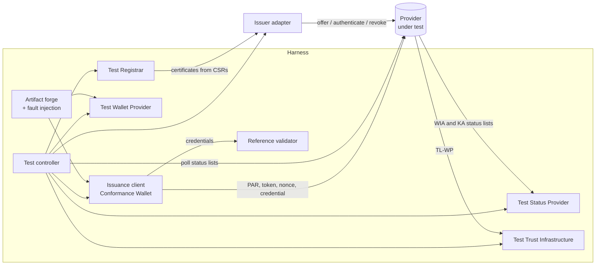

# Issuer conformance harness: design addendum

Draft 0.3, 2026-11-26 (decisions on the open points applied, see §12; phases I0 to I4 done, see §10). Addendum to [harness-design.md](harness-design.md) for the issuing side: how the harness executes the test objectives of [issuer-test-catalogue.md](issuer-test-catalogue.md) (182 objectives, draft 0.2) against a PID Provider or Attestation Provider. It describes only what differs from the RP harness. Everything not mentioned here (verdict model, evidence, reports, JUnit XML, known findings, CI conventions) works as harness design sections 5 to 8 describe. Phases I0 to I4 (§10) are implemented. Section 9 of the catalogue lists this addendum as step 2.

## 0. Summary

On the RP side the harness plays every party around the Relying Party. On the issuer side it plays every party around the Provider: the wallet (as OpenID4VCI client), the Wallet Provider that attests the wallet, the Wallet Provider's status provider, the trust infrastructure that publishes `TL-WP`, and a registrar that certifies the Provider's keys. It sends the Provider valid requests and requests with exactly one deliberate fault. It then reads the Provider's answer, checks what the Provider issued and publishes, and compares the result with the expected result of the catalogue.

Key choices:

- **One repository, shared packages** (catalogue decision 7). `forge`, `validator`, `status-provider`, `trust-infrastructure`, `controller`, `fcaf-render` and `core` serve both SUTs. The issuer suite adds packages of its own and keeps its definitions and adapters apart from the RP ones.
- **Same method**: valid first, then one named fault. Faults are self-validated against a reference before they are used. Executable definitions are the single source of truth. Positive controls gate every `_UF` test.
- **The SUT's answer is the outcome.** Unlike an RP, a Provider answers every request directly (HTTP status and error object, or credentials), so most verdicts need no adapter call. The adapter is needed only for what happens outside the protocol: creating offers, authenticating the test subject, revoking, changing subject data.
- **The reference validator becomes the checker of what is issued** (`OBS-CRED`). The same named checks a Relying Party must run are now run on the Provider's output, plus data model checks for the PID Rulebook.
- **EUDIPLO is the reference issuer** (decision 2, §12). The reference validator proves that each fault fails exactly its check. EUDIPLO's issuer proves that the executable test cases can pass. There is no reference issuer of the harness's own.

## 1. Goals and non-goals

Goals:

1. Execute the executable objectives of the issuer catalogue unattended against any PID Provider or Attestation Provider that offers the ICS items and an adapter, with FCAF verdicts and evidence.
2. Run nightly against EUDIPLO's issuer, in the same Compose setup and job as the RP run.
3. Reuse the RP harness wherever the artifact or the check is the same, so that a fix on one side applies to both.

Non-goals for now:

- The test book `PP_TB_*` (14 items). They are inspections, and the harness only lists them in the report as REVIEW with their method.
- Identity proofing (ISSU_18) and a real User login. The adapter authenticates the test subject (catalogue §3.5).
- Issuance over the W3C Digital Credentials API (ISSU_03), QTSP access to Authentic Sources (QTSPAS_*), ZKP. All are out of scope in the catalogue (§1).
- Testing the Wallet Provider itself. The Test Wallet Provider is a test role, not a SUT.

## 2. What the catalogue needs from a harness

| Capability | Used by | Notes |
| --- | --- | --- |
| Fetch and check Credential Issuer and Authorization Server metadata, plain and signed | `MS_Metadata`, `AP_WS_MS_Metadata` | `OBS-META`; signed metadata validates to `TL-AC`, the registration certificate to `TL-RC` |
| Obtain a credential offer for a subject and configuration, by value or by reference | all `SCN-I` | Adapter `createOffer` |
| Pre-authorized code flow, with `tx_code` | `PA` variants | `tx_code` comes from the adapter |
| Authorization code flow with PAR, PKCE, `issuer_state`, and the subject's authentication | `AC` variants | Adapter `authenticateSubject` completes the login |
| OAuth client attestation: WIA and PoP at PAR and token endpoint | all; `SM_ClientAttestation` | WIA from the Test Wallet Provider, with faults |
| DPoP proofs, server nonces, refresh tokens | all; `SM_TokenBinding`, `IA_Reissuance` | Faults on `htm`, `htu`, `ath`, `iat`, `jti`, key, nonce |
| Nonce endpoint and proofs (`openid4vci-proof+jwt`) with the KA in the `key_attestation` header, and the `attestation` proof type | all; `SM_ProofOfPossession`, `SM_KeyAttestation` | KA from the Test Wallet Provider, with faults |
| Batch requests, deferred issuance, notifications, encrypted requests and responses | `IA_Batch`, `IA_Deferred`, `IA_Notification`, `SH_Encryption` | Per ICS |
| Issue WIAs and KAs under `TL-WP`, with controllable claims, validity, levels and status | `SM_ClientAttestation`, `SM_KeyAttestation`, chaining | New role: Test Wallet Provider |
| Serve and change the WIA and KA status lists (`SL-WP-A`) | `ClientAttestation_012`, `_013`, `KeyAttestation_008`, `_009`, `SM_Revocation_006`, `_007` | Test Status Provider, as on the RP side |
| Publish `TL-WP` and new or faulty versions | `PP_Inf_SM_TrustMechanisms` | Test Trust Infrastructure, as on the RP side |
| Certify the SUT's keys from CSRs under the test PKI | every trust test (catalogue §3.3, decision 6) | New role: Test Registrar |
| Validate every issued credential, and the data model | `OBS-CRED`; `SM_IssuerIntegrity`, `SM_Validity`, `DM_*` | Reference validator plus PID Rulebook checks |
| Fetch and poll the SUT's status lists and identifier lists | `OBS-SL`; `SM_Revocation`, `PP_RP_*` | `REVOKED(t)`, `UNCHANGED`, list size, renewal before `exp` |
| Trigger back-office events | `SM_Revocation_003`–`_005`, `_008`, `IA_Reissuance_004` | Adapter `revoke`, `suspend`, `changeSubject` |
| Log the SUT's outbound requests | `OBS-NET`; `SH_Encoding_003`, `_004`, `PP_Inf_008` | Logs of the Test Status Provider and the Test Trust Infrastructure |
| Present an issued credential to the reference RP | `PP_RP_SM_Revocation_008` | The RP harness's Conformance Wallet and reference RP, unchanged |

## 3. Architecture



| Component | Responsibility | Status |
| --- | --- | --- |
| Test controller | Loads the ICS and the issuer definitions, selects test cases, gates on positive controls, executes steps, evaluates, reports | Shared, generalised (§4) |
| Artifact forge | Test PKI, status lists, LoTEs, valid credentials for the output-side self-validation (§7). New: WIA, PoP, KA, proofs, DPoP proofs with faults | Shared, extended |
| Issuance client | The wallet side of OpenID4VCI: offer, both grants, client attestation, DPoP, nonce, proofs, batch, deferred, notification, refresh. Applies one fault per step | New (§5.1) |
| Test Wallet Provider | Wallet Units `CW-1`, `CW-2`, `CW-B`: issues their WIAs and KAs under `WP-A` or `WP-B`, and revokes them | New (§5.2) |
| Test Registrar | Issues the SUT's signing, access and registration certificates from CSRs | New (§5.3) |
| Test Status Provider | Serves `SL-WP-A` and `SL-WP-B` (WIA and KA status lists) with programmable behaviour; logs the SUT's fetches | Shared, unchanged |
| Test Trust Infrastructure | Serves `TL-WP`, `TL-PID`, `TL-AC`, `TL-RC` and the others, versioned; logs the SUT's fetches | Shared, unchanged |
| Reference validator | Checks every issued credential and every published status list (`OBS-CRED`, `OBS-SL`); new: issuer request checks for the self-validation, PID Rulebook checks | Shared, extended (§7) |
| Issuer adapter | The only Provider-specific code (§5.4) | New |

Host names stay `*.rp-test` until the repository is renamed (catalogue decision 7). The issuer suite reuses the RP suite's TLS CA, which the SUT must trust.

## 4. Reuse and generalisation of the shared packages

| Package | Reused as is | Generalised or extended |
| --- | --- | --- |
| `core` | `Verdict`, relevancy, `IcsCondition`, the HTTP helpers, request logs, the check result model | `definition.ts` and `adapter.ts` are RP-specific today (`Flow`, `DefaultQueryId`, `RelyingPartyAdapter`, `RP.*` ICS items). Split them into a SUT-neutral part (test case fields, steps, expectations, ICS conditions) and an RP part. The issuer part adds the issuer step actions (§6), expectation codes and `IssuerAdapter`. `faults.ts` gets the issuer fault points (§6.2) |
| `forge` | Test PKI and `ENTITIES`, LoTE writing and sealing, Status List Tokens (JWT, CWT) with all their faults, identifier lists, Trusted Lists, `default_credential_A`, PID issuance (for the output-side self-validation, §7), registration certificates | New entities and list content (§5.2, §5.3). New builders for WIA, PoP, KA, proofs and DPoP proofs, with their faults. An entity `PP-T` whose CAs certify keys from CSRs instead of generating them |
| `validator` | All 9 credential checks except `key-binding`, all Status List Token and identifier list checks, path validation, `TrustStore`, `TRUST_RULES` per category | `key-binding` becomes `holder-binding` on the issuer side: `cnf.jwk` or `deviceKeyInfo` equals a proof key and one of the KA's `attested_keys`, since there is no presentation. New: PID Rulebook checks (`DM_*`), metadata checks (`MS_Metadata`), and issuer request checks for the self-validation (§7) |
| `status-provider` | Unchanged: per-URL artifacts, programmable behaviour, request log | None |
| `trust-infrastructure` | Unchanged: namespaced, versioned lists, retrieval log | None |
| `controller` | Selection, gating, step execution, report, JUnit XML, known findings, CLI conventions | A runner per SUT kind behind one CLI (`eudi-pcaf issuer run --adapter … --ics …`). New evaluators for the issuer codes (§6.3). Long-running steps (`REVOKED(t)` with `t` up to 24 h) are scheduled after the others |
| `fcaf-render` | Test case rendering, lint integration | A second overlay, `fcaf-overlay-issuer/`, for the issuer test cases (decision 1, §12) |
| `wallet`, `reference-rp`, `dc-api-shim` | Used only by `PP_RP_SM_Revocation_008`: the issued credential is presented to the reference RP | None |

## 5. New components

### 5.1 Issuance client (Conformance Wallet for OpenID4VCI)

New package `packages/issuer-wallet`, built on `@openid4vc/openid4vci` and `@openid4vc/oauth2` (the same family as the OpenID4VP wallet side), with a fault layer that builds or changes messages directly where the libraries would refuse a faulty one.

- **Offer**: resolves `credential_offer_uri` (recording content type and scheme), or takes the offer by value. It records the offer for `MS_Offer`.
- **Metadata**: fetches the Credential Issuer metadata as JSON and with `Accept: application/jwt`, and the Authorization Server metadata. It records both for `MS_Metadata`.
- **Client attestation**: sends `OAuth-Client-Attestation` (the WIA) and `OAuth-Client-Attestation-PoP` at PAR and at the token endpoint. The PoP is signed with the WIA's `cnf` key and has a fresh `jti` and `iat`, and `aud` set to the issuer.
- **Pre-authorized code flow**: token request with `pre-authorized_code` and `tx_code`.
- **Authorization code flow**: PAR with PKCE `S256` and `issuer_state`. The authorization request with the PAR `request_uri` goes to the adapter's `authenticateSubject`, which returns the redirect with `code`, `state` and `iss`. Then the token request with `code_verifier`.
- **DPoP**: one DPoP key per Wallet Unit. Proofs carry `htm`, `htu`, `iat`, `jti`, and `ath` at the credential endpoint. The client answers `use_dpop_nonce` with one retry, unless the step forbids it (`TokenBinding_006`).
- **Proofs**: fetches `c_nonce` from the nonce endpoint. Each proof is an `openid4vci-proof+jwt` signed with one of the KA's attested keys, with the KA in the `key_attestation` header. Where the metadata offers the `attestation` proof type, the client can send the KA alone. A batch sends N proofs, one per attested key.
- **Credential request** by `credential_configuration_id` or `credential_identifier`, optionally encrypted (`credential_response_encryption`). The client handles deferred responses (polling at `interval`), notifications, and the refresh grant with the original DPoP key.
- **Evidence**: every request and response with headers. Credentials are stored as received and passed to the reference validator with the proof keys, the KA and the subject data.

One fault per step, as on the RP side. A fault names its point (§6.2), and the step's other messages are built valid. Every step that expects `REJ` checks first that the SUT issued neither a token nor a credential.

### 5.2 Test Wallet Provider

New package `packages/wallet-provider`, mostly forge builders.

- **Trust configuration**: `TL-WP` today lists only `WP-A`. It gets the catalogue's content (§3.2):
  - `WP-A`, with separate CAs for WIA signing, KA signing and their status lists
  - `WP-B`, a second granted Wallet Provider
  - `WP-W`, withdrawn
  - `WP-C`, added in a later version for `PP_Inf_003`

  The services and their types follow ETSI TS 119 602 for Wallet Providers lists. The withdrawn status is expressed the way that list type allows, as `PP-W` does on `TL-PID` (harness design §11, Phase 1).
- **Wallet Units** `CW-1`, `CW-2` (both `WP-A`) and `CW-B` (`WP-B`):
  - a WIA with a fresh `cnf` key and a status reference into `SL-WP-A` (`SL-WP-B`)
  - a KA with `key_storage` and `user_authentication` `iso_18045_high`, `attested_keys` as many as the batch size, and its own status reference
  - a revocation maintenance period of more than one year

  Claim names follow TS3 at the ARF commit of the catalogue (catalogue §8.2).
- **Controllable values**: every claim, the validity, the levels, the maintenance period, the signer (any entity of the trust configuration, `CA-X`, the wrong service anchor) and the algorithm are step parameters or faults (§6.2).
- **Revocation**: `revokeInstance(unit)` and `revokeWscd(unit)` publish a new version of `SL-WP-A` with the WIA or KA status set. The Test Status Provider serves it under the same URL, and its log shows when the SUT fetched it. This drives `ClientAttestation_012`, `KeyAttestation_008` and the chaining tests `SM_Revocation_006` and `_007`.
- **Status list faults**: `ClientAttestation_013` and `KeyAttestation_009` reuse the 54 Status List Token faults and the HTTP behaviours of the RP harness unchanged. They are the same faults, now served to the issuer.

### 5.3 Test Registrar and SUT enrolment

New module of the forge. Enrolment is required (catalogue decision 6).

1. The adapter's `enrol(csrs)` hands the SUT's CSRs to the harness. There is one CSR per signing key: credential signer(s), status list signer, access certificate key. Where a SUT cannot produce CSRs but can import keys, the Registrar generates the keys and the adapter imports them; the report records which way was used.
2. The Registrar issues:
   - the credential signers under the issuance anchor of the SUT's entity (`PP-T`, `QP-T`, `PB-T` or `EP-T`), in the ETSI TS 119 412-6 profile of its category; for mdoc, the document signer profile of ISO/IEC 18013-5 Annex B, as for `PP-A`
   - the status list signer under the revocation anchor, unless the SUT declares that it signs status lists with its issuance key (catalogue §3.3)
   - the access certificate from `AC-A`, with the entity identifier, service identifier and trade name of `default_configuration_PP_1`
   - the registration certificate from `RC-A`, with `entitlement` and `providesAttestations` from the ICS
3. `PP-T` is published in `TL-PID` (or `QP-T` in `TL-QEAA`, `PB-T` in `TL-PUB`), so the reference validator and the reference RP validate the SUT's output with the same `TRUST_RULES` as any other entity.

Enrolment runs once per run, before the first test case. It is the reason the anchors of `PP-T` are generated per run but its leaf keys are not.

### 5.4 Issuer adapter

```ts
// Illustrative, not final API.
interface IssuerAdapter {
  name: string;
  /** Configure the SUT: trust in TL-WP, its certificates from the Test Registrar, its configurations per the ICS. */
  setUp(env: IssuerTestEnvironment, namespace: string): Promise<void>;
  /** CSRs for the SUT's keys (§5.3), or undefined when the Registrar must generate the keys. */
  enrol(): Promise<EnrolmentRequest | undefined>;
  createOffer(req: {
    subject: 'SUBJ-1' | 'SUBJ-2';
    configurations: string[];
    grant: 'pre-authorized_code' | 'authorization_code';
    byReference: boolean;
  }): Promise<{ offer: string; txCode?: string; sessionId: string }>;
  /** Complete the subject's authentication for an authorization request and return the redirect with `code`. */
  authenticateSubject?(authorizationRequestUrl: string, subject: string): Promise<string>;
  /** Revoke, suspend or unsuspend what the session issued; resolves when the SUT reports it done (`OBS-ADM`). */
  setStatus?(sessionId: string, status: 'revoked' | 'suspended' | 'valid'): Promise<{ at: string }>;
  /** Replace SUBJ-1's data with SUBJ-2's (SM_Revocation_008). */
  changeSubject?(from: string, to: string): Promise<void>;
  /** Make the SUT fetch TL-WP now instead of waiting T_refresh. */
  refreshTrust?(namespace: string): Promise<void>;
  describe?(): Promise<Record<string, string>>;
  tearDown?(): Promise<void>;
}
```

Optional hooks map to ICS items: no `authenticateSubject` means `P-AC` cannot run, no `setStatus` means `P-HOOK` is No, and no `changeSubject` makes `SM_Revocation_008` NOT APPLICABLE (catalogue decision 5).

| Adapter | How |
| --- | --- |
| EUDIPLO (reference, §5.5) | One tenant per namespace, as for the RP adapter:<br/>- `setUp` imports the key chain with the Registrar's certificates (`/api/key-chain/import`) and creates the credential and issuance configurations: `walletAttestationRequired`, `walletProviderTrustLists` naming `TL-WP`, `keyAttestationsRequired` with the levels of the ICS, `statusManagement`, and `revokeWithWalletUnit` for chaining.<br/>- `createOffer` calls `POST /api/issuer/offer`.<br/>- `setStatus` calls `POST /api/session/revoke`, and `GET /api/session/:id/credential-status` confirms it.<br/>- `authenticateSubject` uses EUDIPLO's chained or interactive authorization with a scripted login.<br/>- `refreshTrust` uses the trust list cache endpoint the RP adapter already calls.<br/>The exact calls are confirmed when the adapter is written. |
| Manual | Prints offers and asks the tester for back-office events; verdicts that depend on them become REVIEW |

### 5.5 EUDIPLO as the reference issuer

Decision 2 (§12): the harness has no reference issuer of its own. EUDIPLO's issuer, through its adapter, takes the part the reference RP has on the RP side: an executable test case counts as validated once it has passed against EUDIPLO. EUDIPLO runs in the Compose setup the RP suite already uses, so it is available to every developer and to CI.

What this changes compared with the RP harness:

- **Faults are still proven without the SUT.** Each fault must fail exactly its target check of the reference validator (§7, level 1), which needs no issuer. That part of the self-validation stays in `pnpm test`.
- **Test cases are proven against EUDIPLO.** The reference run (§7, level 3) needs Docker and a running EUDIPLO, so it runs in its own CI job, not in `pnpm test`.
- **A failure has two possible causes**: a fault in the harness or a defect in EUDIPLO. Every FAIL in the reference run is analysed before it is recorded. A defect in EUDIPLO becomes a known finding (`adapters/issuer-eudiplo/known-findings.yaml`) with a reference to the upstream issue. The report marks the test case **not validated** until EUDIPLO is fixed and the test case passes. A fault in the harness is fixed.
- **Features EUDIPLO lacks** (for example a hook the adapter cannot offer, or an ICS item it declares No) leave the test cases that need them not validated as well. They stay in the suite, run against other Providers, and are listed in the report and in the delivery phases with the reason.
- **Version pinning**: the reference run uses a pinned EUDIPLO image, so a change on EUDIPLO's `main` cannot invalidate the suite overnight. Since 2026-11-20 the pin is a digest of the main image (`10.0.0-main.7586139` since 2026-11-23, `9.1.0-main.ae0792a` before; in `adapters/issuer-eudiplo/reference.env`), not a release: the release 9.1.0 lacks enrolment by CSR, the strict status check of wallet and key attestations, the key attestation status check and revocation chaining (`revokeWithWalletUnit`), which the catalogue tests. The pin moves to a release once one has these features. The nightly job (§8) runs against `main` separately and reports regressions as findings, not as harness failures.
- **Time-based test cases** (`REVOKED(t)`) need short `T_rev` and `T_chain` in EUDIPLO's configuration. The adapter sets the shortest values EUDIPLO allows, and the ICS declares them.

## 6. Definitions, steps, faults and expected results

### 6.1 Definitions and steps

Issuer definitions live in `packages/issuer-definitions/src/<class>/<layer>/<Area>.ts` (for example `pid_provider/SecurityMechanisms/KeyAttestation.ts`), in the same `defineTestCase` form, with the same rendering to FCAF markdown. Variants (`SD`/`MD`, `PA`/`AC`, `PID`/`Q`/`PB`/`E`) are expanded by functions, as RP definitions expand formats and flows.

Step actions:

| Action | Does |
| --- | --- |
| `metadata` | Fetches the metadata (`SCN-M`) |
| `issuance` | Runs `SCN-I` for a Wallet Unit, subject, configurations, grant and batch size, with at most one fault. Optional: stop after the token response, deferral, encryption, `credential_identifier` |
| `token-reuse` | Repeats a request of an earlier step (code, PAR `request_uri`, refresh token, `transaction_id`, DPoP proof, proof) |
| `wallet-event` | The Test Wallet Provider revokes an instance or a WSCD, or changes `SL-WP-*` |
| `issuer-event` | Adapter `setStatus` or `changeSubject` |
| `trust-list` | Publishes a version of `TL-WP`, as the RP harness's trust-list step does for `TL-PID` |
| `observe-status` | Polls `OBS-SL` for the credentials of earlier steps until `t` or the expectation is settled |
| `present` | Presents a credential of an earlier step to the reference RP (`PP_RP_SM_Revocation_008`) |

### 6.2 Fault points

Faults keep the RP harness's model: a named, pure function at one point, applied after a valid build, listed in `core/src/faults.ts` with its point, its target check and its FCAF wording.

| Point | Faults (from the catalogue) |
| --- | --- |
| `wia` | missing; signature bit flip; signer `CA-X`, `PP-A`, `AC-A`, `WP-W`, `WP-A`'s KA CA; `exp` past; `nbf` future; `typ` `JWT`; `ES256K`, `HS256`; `sub` other than `client_id`; maintenance period ending in 30 days or tomorrow; `uri` to the TSP under `CA-X`; `uri` to a private address; `jku`/`x5u` header |
| `wia-pop` | missing; other key; `aud` other; `iat` stale; `jti` replayed; `typ` `JWT` |
| `ka` | missing; signature bit flip; signer `CA-X`, `PP-A`, `WP-W`, `WP-A`'s WIA CA; `exp` past; `nonce` of another session or missing; levels `iso_18045_moderate`, `basic` or absent; `typ` `JWT`; `ES256K`; KA of another Wallet Unit; maintenance period ending in 30 days |
| `proof` | signature bit flip; `alg` `none`, `HS256`, `ES256K`; `typ` `JWT` or absent; `aud` other or absent; `nonce` missing, random or replayed; `iat` ±1 h; `iss` other; private key in `jwk`; `jwk` and `x5c`; off-curve point; P-521; key not in `attested_keys`; batch: one bad proof, one key twice, `batch_size` + 1 proofs |
| `dpop` | missing; Bearer instead of DPoP; other key; `htm`, `htu`, `ath` wrong or missing; `iat` stale; `jti` replayed; nonce omitted |
| `authorization` | no PAR; no PKCE; `plain`; wrong `code_verifier`; reused or expired PAR `request_uri`; reused code; other `client_id` or `redirect_uri`; unknown `authorization_details` or `scope` |
| `token-request` | reused or expired pre-authorized code; code of another offer; wrong, missing or repeatedly wrong `tx_code`; refresh with another DPoP key |
| `credential-request` | unknown configuration; configuration not covered by the token; both or neither identifier; foreign `credential_identifier`; extra member (must pass); unknown or redeemed `transaction_id`; foreign access token; unadvertised `alg` or `enc`; off-curve encryption key; expired access token |
| `encoding` | truncated JSON; `text/plain`; two-part JWT; 10 MB body; nesting depth 10 000 |
| `status-list` | the RP harness's 54 Status List Token faults and HTTP behaviours, applied to `SL-WP-*` |
| `trust-list` | the RP harness's 7 trust-list faults, applied to `TL-WP` |

That is about 100 new named faults before format and grant variants, plus the 61 status list and trust list faults the RP harness already has. Time faults use the SUT's declared `T_proof` and `T_skew` plus one hour, capped as the catalogue says (§3.5).

### 6.3 Expected results

| Code (catalogue §2.5) | Check |
| --- | --- |
| `ISS` | HTTP 200 (or 202 with a later credential), and every credential passes every check of the reference validator with the suite's trust configuration: format, `issuer-trust` to `PP-T`, `issuer-signature`, `disclosures`, `validity`, `holder-binding`, `status-reference`, and the data model checks the test case names |
| `REJ` | HTTP 4xx with an OAuth or OpenID4VCI error object; no token and no credential issued in the step; never 5xx. The error code is recorded (catalogue decision 1) |
| `REJ:<code>` | `REJ` with that `error`; where the code requires it, also a fresh `c_nonce` or a `DPoP-Nonce` header, and a retry that the step then expects `ISS` for |
| `CONF` | The named checks pass on the captured artifact (metadata, offer, credential, status list). Each `CONF` test case names its checks, as `CONF` does on the RP side |
| `REVOKED(t)` | `observe-status` sees the credential revoked in a list the SUT publishes no later than `t` after the event, and revoked in every later version until the step ends |
| `UNCHANGED` | Valid in every version polled during the step |
| `NOFETCH` | No request for the named URL in the Test Status Provider or Test Trust Infrastructure log during the step |
| `POLICY` | Compared with the ICS declaration the expectation names (ICS-07, ICS-15, ICS-18) |
| `INFO` | Recorded in the report; the step's verdict is PASS |

`OBS-SL` polling: the poll interval is `min(t / 20, 30 s)`, and every version polled is kept as evidence with its `iat`, `exp` and the credential's status. A step that waits `t` runs in parallel with other test cases. The controller schedules such steps last, and the nightly job runs with the declared values of minutes (catalogue decision 3).

## 7. Self-validation

The RP harness's three levels carry over:

1. **Artifacts**: every WIA, PoP, KA, proof and DPoP proof the forge builds valid passes every issuer request check of the reference validator. Each fault fails exactly its target check and no other. The new issuer request checks (`wia-signature`, `wia-trust`, `wia-validity`, `wia-status`, `wia-pop`, `ka-signature`, `ka-trust`, `ka-levels`, `ka-status`, `proof-signature`, `proof-claims`, `proof-nonce`, `proof-key-attested`, `dpop-proof`, `dpop-binding`, `pkce`, …) are named per point, as the RP side's credential, status and request checks are. The checks for status lists and trust lists are the existing ones.
2. **Definitions**: every step of every executable issuer definition, built as the controller builds it, passes every check when the step expects `ISS` and fails exactly one check when it expects `REJ`.
3. **Reference run**: every executable test case passes against EUDIPLO (pinned image, §5.5) in every variant it runs in, or is marked not validated with an analysed reason (a known finding or a missing feature). This runs in its own CI job, since it needs Docker.

The output side is validated without the SUT. Credentials and status lists that the forge builds valid (the PID and `default_credential_A`, both formats) must pass every `OBS-CRED` and `OBS-SL` check. For each `CONF` check, a forge-built credential or list with the matching fault must fail it. That reuses the RP harness's credential and Status List Token faults, which already exist for exactly these checks. Levels 1 and 2 and the output side run in `pnpm test`.

## 8. Deployment and CI

- The issuer run uses the same Compose file as the EUDIPLO RP run. One EUDIPLO instance serves both suites, in separate tenants.
- The nightly job gets a second step after the RP run: `eudi-pcaf issuer run --adapter eudiplo --ics adapters/issuer-eudiplo/ics.yaml --known-findings adapters/issuer-eudiplo/known-findings.yaml`, with its own report, JUnit suite and artifact.
- The fault and output self-validation of the issuer suite (§7, levels 1 and 2) is part of `pnpm test`. The reference run against the pinned EUDIPLO image is a CI job of its own on every pull request that touches the issuer suite, since it needs Docker.

## 9. Gaps and risks

| Item | Impact | Mitigation |
| --- | --- | --- |
| TS3 claim names for WIA and KA still change | WIA and KA builders and checks | Names in one module of the forge, pinned to the ARF commit of the catalogue; recorded in the report |
| No public WIA/KA status list profile beyond Token Status List | `SL-WP-*` format | Use Token Status List (JWT) as TS3 does; CWT only if TS3 asks for it |
| SUTs that cannot take certificates from the test PKI | Cannot run the automated suite (decision 6) | Reported as NOT APPLICABLE for the whole run with the reason; the manual adapter remains |
| User authentication in the authorization code flow is SUT-specific | `AC` variants | Adapter hook; without it the `AC` variants are NOT APPLICABLE |
| `T_rev` and `T_chain` of up to 24 h | Long runs | Declared values; nightly with minutes; long steps run in parallel and last |
| `@openid4vc/openid4vci` refuses faulty messages | Fault injection | Fault layer assembles JWTs and HTTP requests directly, as on the RP side |
| OpenID4VCI and HAIP section numbers in the catalogue not checked against the FCAF-pinned versions (catalogue §8.2) | Wrong references in rendered test cases | Checked when the definitions are written |
| Issuer classes are not reserved in the FCAF methodology (catalogue §8.2) | FCAF contribution | Rendered in the separate overlay `fcaf-overlay-issuer/` (decision 1) until the FCAF maintainers agree |
| EUDIPLO as the reference (decision 2): a harness fault and an EUDIPLO defect look alike | False FAIL, or a false PASS when both are wrong the same way | Faults proven by the reference validator alone (§7, level 1); every FAIL analysed before it becomes a known finding; test cases EUDIPLO cannot pass marked not validated (§5.5) |
| EUDIPLO lacks a feature the catalogue tests | Test cases that cannot be validated | Listed per phase with the reason; validated later against another Provider or when EUDIPLO adds it |

## 10. Delivery phases

| Phase | Content | Test cases enabled |
| --- | --- | --- |
| I0 | `core` split into SUT-neutral and RP parts (the RP suite stays green); Test Wallet Provider with `TL-WP` and `SL-WP-A`; Test Registrar and `PP-T`; issuance client for the pre-authorized code flow with WIA, PoP, DPoP, nonce, proof and KA; `IssuerAdapter` and the EUDIPLO issuer adapter (the reference, decision 2); `holder-binding`; the reference-run CI job | Positive control `PP_WS_IA_MainInteraction_001` (`SD`, `PA`), passing against EUDIPLO. Done (issues 12 to 17) |
| I1 | The catalogue's first baseline (§9 step 4): authorization code flow, mdoc, `SM_ClientAttestation`, `SM_KeyAttestation`, `SM_ProofOfPossession`, `SM_Validity`, `SM_Revocation_001`–`_003`, `DM_PidSdJwt`, `DM_PidMdoc`, `PP_RP_SM_Revocation`; rendering to `fcaf-overlay-issuer/` | About 70 objectives before variants, each validated against EUDIPLO or marked not validated with the reason. Done (issues 18 to 22 and 24; the overlay with issue 23) |
| I2 | Nightly step against EUDIPLO `main`, known findings for the issuer suite | Same, against EUDIPLO `main`. Done (issue 23, with the overlay and the site) |
| I3 | Rest of `PP_WS` (`MS_*`, `TokenBinding`, `Batch`, `Reissuance`, `Deferred`, `Notification`, `IssuerIntegrity`, `Unlinkability`, `SH_*`), revocation chaining, `PP_Inf` | Remaining PID Provider objectives. Done: `MS_*` (issue 24); DPoP, batch, re-issuance, deferred issuance, notification, encoding and encryption (issue 25); revocation chaining, `PP_Inf`, `SM_IssuerIntegrity` and `SM_Unlinkability` (issue 26) |
| I4 | `AP_*`: category variants `Q`, `PB`, `E` of every objective not marked PID only, and the objectives from 100 | Attestation Provider objectives. Done (issue 27): the variants are derived from the `PP_*` definitions (`packages/issuer-definitions/src/attestation_provider/`), the objectives from 100 are written; the runner runs each category against its own Provider instance (its own harness services, enrolment as `QP-T`, `PB-T` or `EP-T`, adapter set-up; for EUDIPLO a tenant each) in parallel with the PID Provider, from the `categories` of the ICS |

Every `PP_*` and `AP_*` objective of the catalogue outside the test book (`PP_TB_*`, inspections) has an executable test case, except `PP_WS_IA_MainInteraction_002` (a Wallet Unit of a second listed Wallet Provider is served the same way). It has no definition of its own; `PP_Inf_SM_TrustMechanisms_001` issues to `CW-B` of `WP-B` next to `CW-1` of `WP-A` and so exercises the same scenario. `pnpm eudi-pcaf issuer --list` lists every test case and variant.

## 11. Relation to the catalogue

The catalogue stays the source of the objectives. The definitions are the source of the test cases, as on the RP side. Where writing a definition shows that an objective cannot be executed as written, the catalogue row is changed in the same commit, with the reason, as Phase 5 of the RP harness did for `RP_Inf_009`.

## 12. Decisions (2026-11-18)

| # | Question | Decision | Applied in |
| --- | --- | --- | --- |
| 1 | Where the issuer test cases are rendered | A separate overlay, `fcaf-overlay-issuer/`, since the FCAF methodology does not reserve the issuer classes. The RP overlay stays as it is. | §4, §9, §10 |
| 2 | What the executable test cases are proven against | EUDIPLO's issuer, through its adapter, at a pinned version. The harness builds no reference issuer of its own. Faults are still proven by the reference validator alone. Since 2026-11-20 the pinned version is a digest of the main image, not a release, until a release has the features the catalogue tests that 9.1.0 lacks (§5.5). | §0, §5.4, §5.5, §7, §8, §9, §10 |
| 3 | OIDF OpenID4VCI issuer suite | Optional, as on the RP side: the harness implements every objective itself, and a bridge to the OIDF suite may come later, outside the phases. | §1 (no dependency) |
