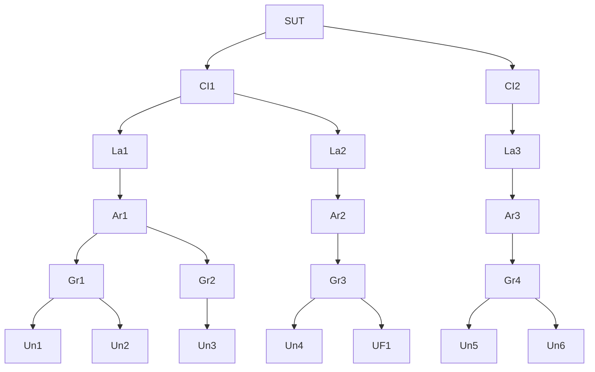
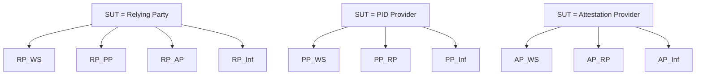

# Methodology

The PCAF uses the methodology of the [FCAF](https://conformance.eudi.dev): the same hierarchical test structure, the same test layers and the same test case format. Where the FCAF defines it for the Wallet Solution, the PCAF applies it to the Relying Party, the PID Provider and the Attestation Provider as Systems Under Test.

The hierarchy is defined as follows:

- **SUT**: System Under Test
- **Cl**: Test Class
- **La**: Test Layer
- **Ar**: Test Area
- **Gr**: Test Group
- **Un**: Test Unit
- **UF**: Test Unit Fraction

*Figure 1: Test case hierarchy*

The upper levels (SUT, class and layer) are stable. Areas and groups evolve as coverage grows.

## Approach

The test cases are developed in three steps:

- **Test structure**: the Systems Under Test and their test classes, from the interfaces each SUT has with its peers.
- **Test objectives**: statements of what is to be tested, taken from the high-level requirements of the [ARF] for each role and from the standards and technical specifications they rely on (OpenID4VP, OpenID4VCI, HAIP, SD-JWT VC, ISO/IEC 18013-5, Token Status List, ETSI TS 119 602 and others), as profiled for the EUDI Wallet. Each objective is traced to its source in the test catalogue of the suite: [Relying Party](../rp/rp-test-catalogue.md), [PID and Attestation Provider](../issuer/issuer-test-catalogue.md).
- **Test cases**: each objective turned into one or more test cases with preconditions, a test scenario and expected results.

The catalogues also record the decisions taken where a requirement leaves a choice, for example which time tolerances apply or what a Relying Party does without revocation information; the overview page of each SUT lists the decisions its test cases apply.

## Systems Under Test

Within the EUDI Wallet ecosystem, several systems may be subject to functional conformance testing:

- Wallet Solutions: tested with the [FCAF](https://conformance.eudi.dev), not part of the PCAF;
- **Relying Parties** (service providers);
- **PID Providers**;
- **Attestation Providers**: QEAA Providers, PuB-EAA Providers and non-qualified EAA Providers;
- Trust infrastructure components: not a SUT of the PCAF; they are peers in its test environment.

> Note: As specified in the European Digital Identity Regulation, legally speaking, the term 'Relying Party' includes Attestation Providers (i.e., QEAA Providers, PuB-EAA Providers, and non-qualified EAA Providers), as well as service providers. However, technically speaking the responsibilities of Attestation Providers are quite different from those of service providers, as is the way they interact with Wallet Units. Therefore, as in the FCAF, the term 'Relying Party' is used in all parts of the PCAF exclusively to mean a service provider interacting with a Wallet Unit to request and receive attributes from an attestation.

## Test Structure

### Test Classes

A **Test Class** groups all functionality associated with one interface of the SUT, that is, with one kind of peer. The PCAF uses the classes that the FCAF methodology names for these SUTs:

- **Relying Party (RP)**
    - **RelyingParty_WalletSolution (RP_WS)**: the presentation interface to Wallet Units, including all checks on the presented credentials.
    - **RelyingParty_PidProvider (RP_PP)**: retrieval and validation of the status information published for PIDs.
    - **RelyingParty_AttestationProvider (RP_AP)**: retrieval and validation of the status information published for attestations. Not yet defined; the `RP_PP` test cases are expected to apply with the same numbers.
    - **RelyingParty_Infrastructure (RP_Inf)**: retrieval and validation of trust lists.
- **PID Provider (PP)**
    - **PidProvider_WalletSolution (PP_WS)**: the issuance interface to Wallet Units, and the PID issued.
    - **PidProvider_RelyingParty (PP_RP)**: the status information published for Relying Parties.
    - **PidProvider_Infrastructure (PP_Inf)**: use of the trust infrastructure.
- **Attestation Provider (AP)**
    - **AttestationProvider_WalletSolution (AP_WS)**
    - **AttestationProvider_RelyingParty (AP_RP)**
    - **AttestationProvider_Infrastructure (AP_Inf)**

*Figure 2: Systems Under Test and test classes*

An Attestation Provider runs every objective of the PID Provider that is not specific to the PID, with the same number, and the objectives specific to Attestation Providers. Every class tests the SUT through an external interface; the PCAF has no class for user-facing functionality, which the FCAF's `WS_UI` class covers for the Wallet Solution.

### Test Layers

Each Test Class is divided into the following layers, as in the FCAF:

- DM - Data Model
- MS - Message Structure
- IA - Interaction
- SM - Security Mechanisms
- UC - Use Cases
- SH - Shared
- O - Others

Each layer comprises Test Areas, which may be divided into Test Groups, and Test Groups into Test Units. The area `MainInteraction` of the `IA` layer of `RP_WS`, `PP_WS` and `AP_WS` holds the positive controls: the valid presentation or issuance that the negative test cases start from.

## Test Cases

Each test case is defined by the following information:

| Term | Description  |
| --- | --- |
| Test Case ID | Uniquely identifies the test case. |
| Objective | Specifies the requirement(s) addressed in this test case. |
| References | Identifies specific references to the requirement(s) addressed by this test case. |
| Profile applicability | Defines the profile(s) for which the test case is applicable, matched against the SUT's ICS. |
| EUDI-wallet relevancy | Indicators on relevance to the EUDI Wallet ecosystem. |
| Technology | Lists technologies that are applicable for the test. It may be omitted. |
| Preconditions | Define the state the SUT and the test environment need to be in before the test case can be executed, usually a default configuration and the positive control that must have passed. |
| Test scenario | Defines the test steps that shall be taken, in the order listed. Each step covers a simple, exactly defined operation with a measurable result. In a negative test case, a step names the one deviation from a valid message or artefact that it applies. |
| Expected results | Define the pass criteria for each test step. Comparing the observed result with the expected result leads to a verdict, "Pass" or "Fail". |
| Comments | Optional comment(s), for example the variants in which the test case runs, or a public test module that covers the same objective. |

### Test Case ID

Test cases are grouped by SUT and Test Class (interface tested).

Test case IDs are formed as follows:

    SUT_TestClass_TestLayer_TestArea_TestGroup_TestUnit_*nnnmmm*

Where *nnn* is a three-digit decimal number identifying the test case.
The identifier may optionally have a postfix *mmm*, which is either a character, an underscore followed by the characters UF for unhappy flow (`_UF`), or a combination thereof (character first). For example, `RP_WS_SM_SessionBinding_004_UF` is a negative test case of the Relying Party, class `RP_WS`, layer `SM`, area `SessionBinding`, and `RP_WS_IA_MainInteraction_001a` is variant `a` of a positive control.

In case one of the subdivisions is not present the name is omitted.

### EUDI-wallet Relevancy

The EUDI Wallet ecosystem uses numerous standards and technical specifications. Many of them have a broader application than EUDI Wallets, while others are specific to them, and they reference, profile and extend each other. Each test case therefore states its EUDI-wallet relevancy with two labels, as in the FCAF.

The first label states the origin of the requirement:

| label | meaning |
| --- | --- |
| EUDI_agnostic | Requirement is defined for general purpose use, and is not relevant to the EUDI Wallet ecosystem. |
| EUDI_generic | Requirement is defined for general purpose use, and is relevant to the EUDI Wallet ecosystem. |
| EUDI_specific | Requirement is specifically defined for the EUDI Wallet ecosystem. |

The second label states the scope of the test case:

| label | meaning |
| --- | --- |
| EUDI_required | Requirement is applicable in the EUDI Wallet ecosystem. |
| EUDI_optional | Requirement is optional in the EUDI Wallet ecosystem. |
| EUDI_forbidden | Requirement is explicitly excluded or prohibited in the EUDI Wallet ecosystem. |
| EUDI_undefined | Applicability of requirement is up to the discretion of the implementer or assessor. |

Some combinations are mutually exclusive, for example agnostic and required, or specific and forbidden.

### Profile applicability

Profiles identify which functionality is in scope for the configuration of the SUT. A test case is selected by comparing its `Profile applicability` with the SUT's Implementation Conformance Statement: the [Relying Party ICS](ics-rp.md) or the [PID and Attestation Provider ICS](ics-issuer.md).

- If no profile is listed in a test case, it shall be executed on every SUT of its kind.
- If one or more profiles are listed and the SUT does not match all of them, the test case shall be skipped for that SUT and marked as Not Applicable in the test report.
